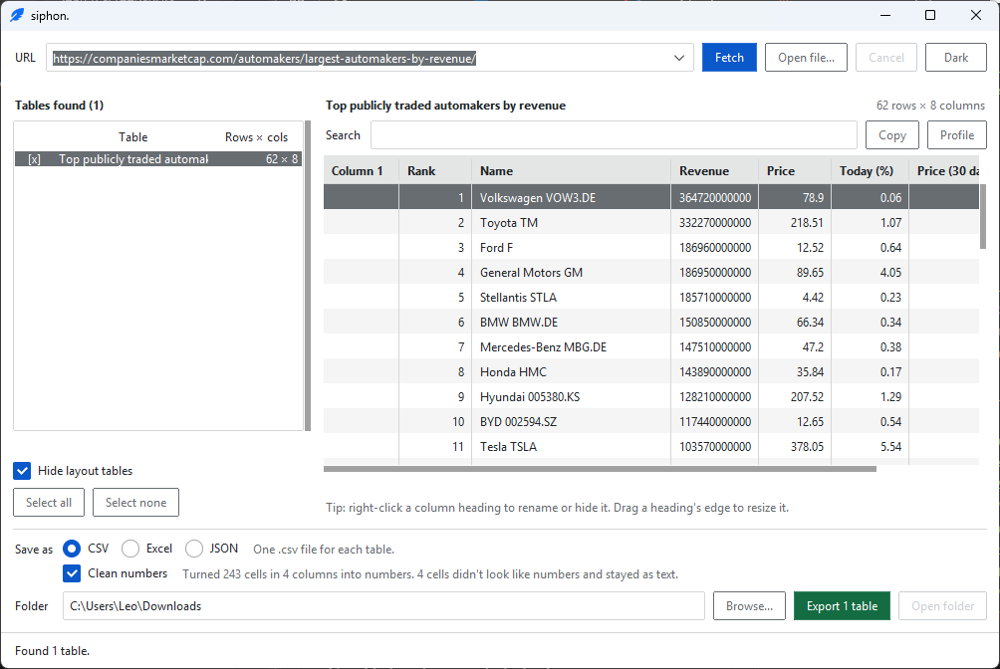
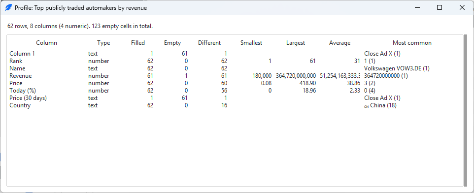
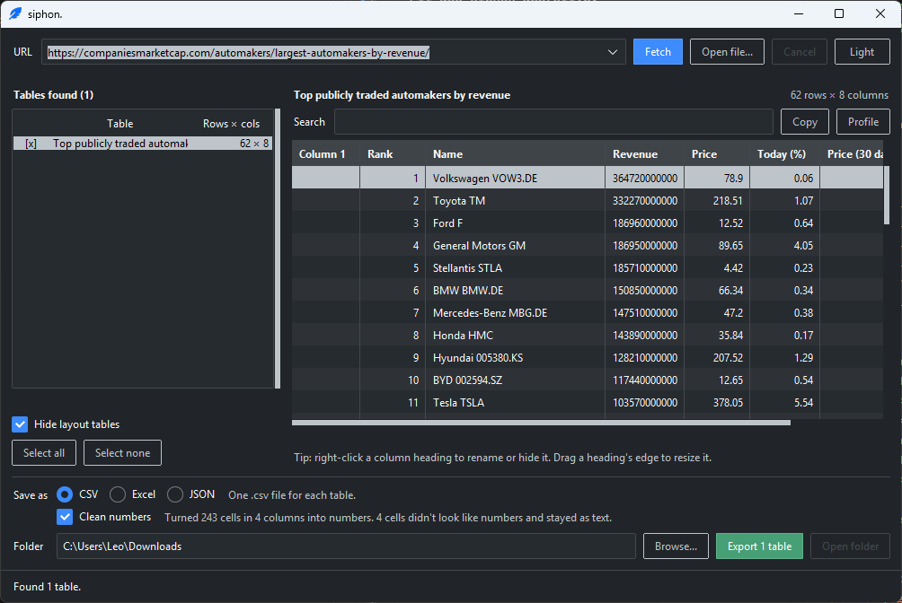

# siphon

Pull the tables off a web page and save them as CSV, Excel or JSON. A small Windows desktop app, with a command-line mode for scripts.



## Why?

Copying tables manually from a browser is tedious and error-prone: columns shift, footnote markers like [1] sneak in, and numbers often paste as plain text so Excel cannot add them up. Siphon solves this by reading the underlying HTML, repairing messy merged cells, parsing and cleaning currency or percentages into real numbers, and ensuring your files are never accidentally overwritten.

## Usecases?

- **Data Analysts & Researchers:** Quickly pulling pricing grids, historical statistics, or demographic tables from static web pages straight into structured Excel workbooks or JSON pipelines.
- **Developers & Scripters:** Using `siphon-cli.exe` inside automated terminal scripts or cron jobs to harvest raw tabular data without writing custom parsing code for every site.
- **Finance & Tracking:** Cleaning text-heavy financial tables where columns mix currency signs, percentages, and accounting brackets into uniform, calculator-ready numbers.

## What it does

- Paste a web address (or open a page you saved from your browser) and siphon finds every table on it.
- Tick the tables you want, preview them, search them, sort them, and copy them.
- Hide or rename columns first: right-click a column heading.
- See a quick summary of any table (which columns are numbers, how many cells are empty, the smallest and largest values) in the Profile window.
- Save as **CSV** (one file per table), **Excel** (one workbook, one sheet per table) or **JSON**.
- "Clean numbers" turns text like `$1,234.50` or `12%` into real numbers, so Excel can add them up. Anything that doesn't look like a number stays as text, so nothing is lost.
- Light and dark themes. It remembers your folder, format, theme, window size and recent addresses.



The dark theme:



## Download

Get the latest zip from the [Releases page](https://github.com/mdcue/siphon/releases), unzip it anywhere and open `siphon.exe`. No Python needed. Windows only for now.

Windows may show a "protected your PC" warning the first time, because the program isn't signed. Choose **More info**, then **Run anyway**.

## Command line

The zip also has `siphon-cli.exe`, which does the same job in a terminal:

```
siphon-cli.exe https://example.com/prices --list
siphon-cli.exe https://example.com/prices -f xlsx -o C:\Users\me\Downloads
siphon-cli.exe saved_page.html -t 2 --raw
```

| Option | What it does |
| --- | --- |
| `-f csv\|xlsx\|json` | what to save as (default `csv`) |
| `-o FOLDER` | where to save (default: the current folder) |
| `-t N` | only table number N (as shown by `--list`); repeat it or write `1,3` |
| `-a`, `--all` | also save tables that look like page layout |
| `-l`, `--list` | show the tables found and stop |
| `--raw` | keep every cell as text |
| `-q` | print only the saved file names |

Saved file names are printed to stdout and messages to stderr, so other programs can use the output. Exit code 0 means it worked, 1 means something went wrong, 2 means a bad command.

## Good manners

Siphon tries to be a polite visitor:

- It reads the site's `robots.txt` and won't fetch a page the site asks robots to avoid.
- It waits at least one second between requests to the same site (longer if the site asks, up to 10 seconds).
- It reuses a page it downloaded in the last 5 minutes instead of downloading it again (`Ctrl+R` forces a fresh copy).
- It tells the site who it is: the User-Agent includes a link to this project.

Please respect each site's terms of use.

## Security

- Only `http` and `https` addresses are accepted, downloads are size- and time-limited, and website certificates are always checked.
- Scraped text can't run as a formula when you open a saved CSV or Excel file.
- Pages nested absurdly deep are refused, so a hostile page can't freeze the app.
- Nothing is sent anywhere except the page requests you start.

The Windows programs are not code-signed, so Windows may warn on first run. Each release lists a SHA-256 checksum for its zip. To report a security problem, see [SECURITY.md](SECURITY.md).

## Limits

- It reads tables that are in the page's HTML. A page that builds its tables with JavaScript, or needs a login, won't show them. Open the page in your browser, save it (File > Save As), and use **Open file** (`Ctrl+O`) in siphon instead.
- Pages bigger than 20 MB are refused. The preview shows the first 300 rows; saving always writes every row.
- Only tested on Windows so far.

## Run it from source

You need Python 3.13.

```
git clone https://github.com/mdcue/siphon.git
cd siphon
git switch main
python -m venv .venv
.venv\Scripts\activate
pip install -r requirements.txt
python -m siphon_app
```

`python -m siphon_app` opens the window; add a web address to use the command line instead. To run the tests: `pip install -r requirements-dev.txt` then `python -m pytest`.

To build the Windows programs yourself, run `build.bat`. It uses PyInstaller and makes `dist\siphon\` (with `siphon.exe` and `siphon-cli.exe`) and a zip.

## How it's built

The code is split in two on purpose:

- `siphon_app/core/` is the brain: download, parse, clean, export. It never imports tkinter, which is why the same code runs in the window and in the command line, and why most of it is tested without a screen.
- `siphon_app/gui/` is the face, built with tkinter and ttkbootstrap. Downloads and exports run in worker threads and report back through a queue, so the window never freezes. The preview grid is drawn on a canvas, because the standard Treeview scrolled sideways too slowly on Windows.

About 600 automated tests cover the parser, cleaner, exporter, polite fetching, command line, the grid and the window itself.

Built with Python, tkinter, ttkbootstrap, requests, BeautifulSoup with lxml, openpyxl and PyInstaller.

## Licence

siphon is free software under the [MIT licence](LICENSE): use it, change it and share it, including commercially. The libraries it is built on are also free to use and share; their licences are listed in `THIRD_PARTY_NOTICES.txt`, which comes inside every release zip.
